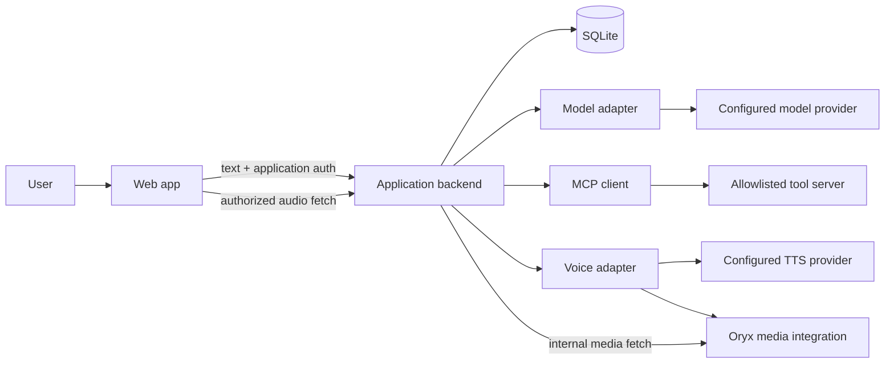

# GNX Voice Agent

A text-first assistant with optional speech input and spoken replies. One application API, replaceable model providers, MCP-connected tools, and an isolated media integration.

**Status:** architecture proposal, not a working application. This repository currently contains the implementation plan only. Provider and media integrations must pass the checks below before they are advertised as supported.

## 1. First approach

Build a reliable text conversation first. Add one read-only tool, then spoken replies, then browser speech input. Do not start with a real-time voice stack.

The first useful experience is:

1. The user types a question in the web app.
2. The app submits a turn and immediately shows a pending state.
3. The backend calls one configured model, optionally using one approved tool.
4. The app displays the answer.
5. If speech was requested and synthesis succeeded, the app offers playback.

Typing always works independently of microphone support. Speech failures never discard a successful text answer.

**Initial scope:** single backend instance, authenticated users, short conversations, one model route, one read-only MCP tool, and optional audio. No streaming, interruption, autonomous background tasks, or write-capable tools in the first release.

## 2. Ownership and boundaries

| Component | Owns | Does not own |
| --- | --- | --- |
| Web app / later PWA | Input, pending/error states, text display, playback, browser capability detection | Provider credentials, routing, tool execution |
| Application backend | Authentication, sessions, conversation history, turn lifecycle, model/tool loop, authorization | Provider internals or media processing |
| Model adapter | Provider-specific requests, response normalization, tool-call translation | Conversation policy or user authorization |
| MCP client and servers | Tool discovery and execution through an explicit allowlist | The model loop or application session lifecycle |
| Voice service adapter | A stable synthesis contract, TTS routing, integration with the chosen media runtime | Agent reasoning or tool selection |
| Oryx integration | Media processing/storage/delivery where verified supported | Conversation orchestration |
| SQLite | Application sessions, messages, turn records, idempotency state | Provider-owned internal sessions |

**MCP is a tool protocol, not an agent orchestrator.** The backend owns the agent loop. Model completion and speech synthesis are internal interfaces; they do not need to be exposed as MCP tools.



All browser traffic is same-origin through the application backend. Provider and Oryx addresses remain internal.

## 3. Integration decisions and evidence gates

The old design assumed that several products already provided the desired end-to-end contracts. This proposal does not make that assumption.

| Integration | Intended role | Required verification |
| --- | --- | --- |
| Hugging Face Inference Providers | Initial hosted model candidate | A specific model/provider combination supports chat and the required tool-call format, with measured latency and account access |
| OmniRoute | Alternative model/TTS gateway | Pin a release; test its configured upstream, authentication, chat/tool support, and speech endpoint independently |
| Oryx | Preferred media runtime candidate | Pin a release; demonstrate supported ingestion, output format, retention/deletion, and authenticated retrieval |
| Browser speech recognition | Optional speech-to-text input | Detect support on the client; document remote processing and permissions for each target browser |
| TTS provider | Text-to-audio generation | Verify model access, language/voice support, audio format, payload limits, and failure behavior |

`POST /v1/voice` is **not claimed to be an existing Oryx endpoint**. The application owns the proposed voice contract. Whether it wraps an existing Oryx facility or requires a small companion service is an integration-spike decision.

Do not depend on removed Oryx AI-Talk code. Do not assume a dubbing pipeline is suitable for low-latency interactive speech. If the media spike fails, ship text-only and record the blocker rather than restoring an entire conversation stack.

### Routing is not a privacy guarantee

Use explicit route names such as `hf-hosted` and `omniroute`, not `public` and `private`. A self-hosted gateway can still forward requests to external services.

A deployment may claim private processing only after verifying **all** model, TTS, STT, tool, telemetry, and storage paths. Disable browser speech recognition when its processing destination cannot meet that policy. Do not silently fail over to an external provider.

## 4. Turn lifecycle

1. Authenticate the user and verify ownership of the session.
2. Validate text length, locale, request size, and the idempotency key.
3. Persist the new turn before calling a provider. Allow only one active turn per session; reject another with `409 SESSION_BUSY`.
4. Load the bounded conversation history and snapshot the current routing configuration.
5. Call the model. Execute only approved tool calls after validating their arguments and checking authorization. Return tool results to the model until it answers or reaches the limit.
6. Persist the final text. If requested and enabled, attempt speech synthesis within the remaining deadline.
7. Persist the terminal response, then return it to the client.

Suggested initial limits: 8,000 input characters, four tool executions per turn, one active turn per session, 45 seconds total, and at most 10 seconds for synthesis within that total. These are tunable starting limits, not latency guarantees. Provider operations must obey the remaining deadline.

Use a token budget for history. Retain the system instructions and newest complete exchanges that fit; do not silently drop the current user message. Automatic summarization is out of scope.

### Retry and crash behavior

A turn ID alone does not make a tool invocation idempotent.

- Store the idempotency key, request hash, status, and response in SQLite, scoped to the authenticated user and session.
- Same key and same request: replay the terminal response, or return `409 TURN_IN_PROGRESS` while running.
- Same key and different request: return `409 IDEMPOTENCY_CONFLICT`.
- Enforce uniqueness in the database, not just in process memory.
- On startup, mark interrupted turns as failed with `TURN_INTERRUPTED`; do not automatically rerun them.
- Retain idempotency records for at least 24 hours. State explicitly that replay protection ends after expiration.
- Retry transient read-only provider/tool operations at most once if the deadline permits. Do not retry authentication or validation failures.

The initial tool is read-only. Future mutations require user confirmation and a durable operation key honored by the tool itself. Do not promise exactly-once effects across arbitrary external services.

## 5. Application API

These are proposed application endpoints, not upstream APIs. JSON uses `session_id` and `turn_id` consistently. Identifiers are opaque ULIDs; they do not grant access.

### Authentication and sessions

Production authentication uses an OIDC authorization-code flow handled by the backend. The browser receives a Secure, HttpOnly, SameSite cookie, never an upstream API key. Validate Origin and require CSRF protection for state-changing requests.

`POST /v1/sessions` creates a session owned by the signed-in user:

```json
{"session_id":"01J00000000000000000000001"}
```

Sessions expire after 24 hours of inactivity initially. The backend stores conversation state; correlation IDs are not a substitute for history. Provide `DELETE /v1/sessions/{session_id}` to delete messages and associated audio, with a tombstone/cleanup retry if upstream deletion fails.

### Submit a turn

```http
POST /v1/turns
Content-Type: application/json
Idempotency-Key: 01J00000000000000000000002
X-CSRF-Token: <application-csrf-token>
```

```json
{
  "session_id": "01J00000000000000000000001",
  "turn_id": "01J00000000000000000000002",
  "text": "¿Qué tengo que hacer hoy?",
  "locale": "es-MX",
  "speak": true
}
```

Require `Idempotency-Key` to equal `turn_id`. The locale is a language preference, not a provider or voice identifier.

Successful response, `200 OK`:

```json
{
  "session_id": "01J00000000000000000000001",
  "turn_id": "01J00000000000000000000002",
  "text": "Hoy tienes tres tareas pendientes.",
  "speech": {
    "status": "ready",
    "url": "/v1/audio/01J00000000000000000000003",
    "mime_type": "audio/mpeg",
    "expires_at": "2026-01-01T12:15:00Z"
  }
}
```

The example expiry is illustrative; actual responses use a future timestamp. Audio references expire 15 minutes after creation initially.

`speech` is always present and has one of these shapes:

```json
{"status":"not_requested"}
```

```json
{"status":"unavailable","code":"VOICE_DISABLED"}
```

```json
{"status":"failed","code":"TTS_TIMEOUT"}
```

A speech failure still returns `200` with the completed text. The first version is synchronous: text arrives after the bounded synthesis attempt, not as a stream. If this delay is unacceptable in testing, introduce asynchronous speech retrieval as a separate, explicit contract change.

### Errors

```json
{
  "error": {
    "code": "MODEL_UNAVAILABLE",
    "message": "The assistant is temporarily unavailable.",
    "retryable": true
  },
  "request_id": "01J00000000000000000000004"
}
```

Use `400` for invalid input, `401` for missing authentication, `404` for absent or inaccessible resources, `409` for lifecycle conflicts, `429` for rate limits, `502` for upstream failure, and `504` for deadline expiry. Never return provider secrets or raw upstream error bodies. Replaying a terminal failure returns that stored failure; a deliberate new attempt needs a new turn ID.

### Audio and capabilities

- `GET /v1/audio/{audio_id}` checks user/session ownership on every request and proxies internal media. Return the actual MIME type, private/no-store caching, and `410` for expired audio accessible to that owner. No public permanent media URLs.
- `GET /v1/capabilities` returns product capabilities only, for example `{"text_input":true,"speech_output":false,"max_input_chars":8000}`. The browser detects its own speech recognition support. Do not expose routing topology here.
- `GET /health/live` checks the process only.
- `GET /health/ready` checks configuration, database access, and required local dependencies. Optional speech failure does not make text unavailable. Diagnose external providers through bounded operational probes, not paid inference on every health request.

## 6. Voice contract

The backend calls an internal interface:

```typescript
type SpeechRequest = {
  userId: string;
  sessionId: string;
  turnId: string;
  text: string;
  locale: string;
  deadline: number;
};

type SpeechArtifact = {
  audioId: string;
  mimeType: string;
  expiresAt: string;
};

interface VoiceService {
  synthesize(request: SpeechRequest): Promise<SpeechArtifact>;
}
```

The voice adapter owns this sequence: select configured TTS → synthesize → hand audio to the verified media integration → register an owned artifact → return its application ID. This is the same path for every model route. Text and speech providers may be configured independently.

Prefer MP3 for the first compatibility test; advertise only formats verified on supported browsers. Transcode only if required and demonstrated. Enforce text, audio-size, and duration limits. Schedule cleanup for expired and orphaned artifacts, and retry failed deletion. Neither a file extension nor an unguessable ID is an access-control mechanism.

Full-duplex speech, WebRTC, HLS, VAD, and barge-in are deliberately out of scope. Short synthesized replies do not by themselves require a streaming media stack.

## 7. Client experience

The UI should clearly show **idle → listening/editing → sending → answered**, with recoverable error states.

- Keep a visible text field and Send button at all times.
- Request microphone permission only after an explicit action.
- Show the recognized transcript for editing before submission.
- Label unsupported speech input and permission denial without blocking typing.
- Provide a Play/Stop control; respect browser autoplay restrictions.
- Prevent accidental duplicate submissions while preserving the pending turn ID for network retries.
- Display speech failure beside the answer, not as a failed conversation.
- Use accessible labels, keyboard operation, readable contrast, and an announced pending/result state.
- Cache only static application assets in a future PWA service worker, never authenticated API responses or audio. Offline inference is not supported.

Browser speech recognition is optional and may send audio to a browser vendor. Explain that before enabling it. A server STT fallback is a later feature with a separate upload API, consent, retention, and security policy; it is not hidden inside the text turn contract.

## 8. Configuration

Keep one validated server configuration. Environment variables hold deployment addresses and secret references; a typed configuration module supplies non-secret defaults and validates combinations at startup. Avoid TOML `${ENV}` substitution unless a loader explicitly implements and tests it.

Proposed environment surface:

```dotenv
APP_ORIGIN=https://agent.example.com
PORT=8080
DATABASE_PATH=./data/agent.sqlite

OIDC_ISSUER=
OIDC_CLIENT_ID=
OIDC_CLIENT_SECRET=
SESSION_SECRET=

MODEL_ROUTE=hf-hosted
HF_TOKEN=
HF_MODEL=
OMNIROUTE_BASE_URL=
OMNIROUTE_API_KEY=
OMNIROUTE_MODEL=

VOICE_ENABLED=false
TTS_ROUTE=
TTS_MODEL=
ORYX_BASE_URL=
ORYX_API_TOKEN=

MCP_CONFIG_PATH=./config/mcp.json
```

Finalize provider-specific TTS settings only after the integration spike establishes the actual contract. Do not invent a universal HF TTS endpoint or assume OmniRoute speech support from chat compatibility.

Route changes require a validated backend restart initially, not a frontend rebuild. No hot reload in the first release. Each turn uses a fixed configuration snapshot. Missing required model settings fail startup; disabled speech needs no speech credentials.

MCP server configuration is application-defined, not a universal MCP JSON schema. Start with a pinned, locally launched stdio server, a fixed executable, a restricted environment, and one named read-only tool. Never accept server commands, upstream URLs, or tool allowlists from client input.

## 9. Security and operations

- Authorize sessions, turns, tools, and audio independently of model output.
- Treat tool results and user content as untrusted data, never as system instructions.
- Validate tool arguments against schemas and enforce user-level resource permissions in the tool adapter.
- Keep provider credentials and internal media addresses server-side; redact them from errors and logs.
- Rate-limit per user and cap request bytes, tokens, tool calls, concurrent turns, and audio generation.
- Restrict outbound service destinations. Never fetch a model-provided URL as a media location.
- Keep the SQLite database and artifacts on a persistent volume. This design supports one application instance; multi-instance scheduling is a later migration.
- Log request/turn IDs, route name, model/tool/voice durations, outcome codes, and usage totals. Do not log raw prompts, transcripts, tool results, or audio by default.
- Retain messages only for the session lifetime; run scheduled cleanup. Document backup retention separately before handling production data.

Measure model latency, total turn latency, speech failure rate, tool failures, and replay counts. Set performance targets after measuring the actual deployment rather than treating sample timings as guarantees.

## 10. Proposed implementation layout

The following files are planned, not present yet. Start with TypeScript on a supported Node.js LTS release, a small HTTP framework, SQLite, and the official MCP SDK. Pin dependencies when scaffolding.

```text
gnx-voice-agent/
├── README.md
├── src/
│   ├── server.ts
│   ├── config.ts
│   ├── api/                 # auth, sessions, turns, audio, health
│   ├── agent/               # bounded model/tool loop
│   ├── storage/             # migrations, history, idempotency
│   ├── providers/           # model and TTS adapters
│   ├── tools/               # MCP client, allowlist, authorization
│   └── voice/               # synthesis contract, Oryx bridge, cleanup
├── web/                     # text UI, optional STT, playback
├── config/                  # non-secret tool configuration
└── tests/                   # contract, integration, browser checks
```

Keep orchestration in the application process. Add services only when required by an actual external integration. No Redis, queue, vector database, or Kubernetes is needed for this scope.

## 11. Implementation milestones and acceptance checks

### A. Prove dependencies

Pin candidate versions. Run isolated chat, tool-call, TTS, and Oryx media round trips. Record commands, versions, redacted responses, latency, and limitations in an integration report.

**Exit:** one working model route chosen; speech either demonstrated end-to-end or explicitly disabled. No unverified dependency is required for the text path.

### B. Ship the text slice

Implement configuration validation, authentication, SQLite migrations, sessions, turns, one model adapter, and the text UI.

**Exit:** a signed-in user can ask two follow-up questions using stored context. Another user cannot read that session. Duplicate requests replay without a second model call. Restart preserves completed turns and marks interrupted work safely.

### C. Add one tool

Connect one read-only MCP tool and implement the bounded loop and argument validation.

**Exit:** the model can use the tool and answer from its result. Unknown tools, unauthorized resources, malformed arguments, timeouts, and loop exhaustion have tests and bounded failures.

### D. Add speech output

Implement the voice interface, verified Oryx bridge, authenticated audio proxy, and cleanup.

**Exit:** requested speech plays in supported browsers; disabled/failed synthesis preserves text. Cross-user audio access fails. Expired and orphaned media is removed. Replaying a completed turn does not regenerate speech.

### E. Add speech input and alternate routing

Add browser capability detection, transcript editing, and the second model adapter only after its contract tests pass.

**Exit:** microphone denial and unsupported browsers still permit typing. Changing the backend model route needs no frontend rebuild. Privacy-restricted deployments never use unapproved browser STT or provider fallback.

### Release gate

Run automated contract tests for both successful and failed turns, ownership, idempotency conflicts, crash recovery, tool limits, deadlines, and audio expiry. Run browser checks for keyboard-only operation, permission denial, playback rejection, and slow networks. Document how to start, configure, back up, and delete data before claiming the app is deployable.

## 12. Corrections to the previous design

- Replaced “MCP owns orchestration” with an application-owned model/tool loop.
- Replaced assumed Oryx voice endpoints with an explicit integration contract and proof gate.
- Separated TTS generation from media handling and defined one consistent direction of flow.
- Removed the claim that an OmniRoute deployment inherently provides private processing.
- Added actual application history, ownership, and durable replay state instead of correlation IDs alone.
- Defined partial speech failure, browser fallback, audio authorization/expiry, and restart behavior.
- Replaced a broad build-everything scope with incremental, testable release gates.

## References to verify during implementation

These are starting points, not evidence that a particular deployment supports every proposed feature.

- MCP specification: https://modelcontextprotocol.io/specification/
- Hugging Face Inference Providers: https://huggingface.co/docs/inference-providers/
- OmniRoute repository: https://github.com/diegosouzapw/OmniRoute
- Oryx repository: https://github.com/ossrs/oryx
- Browser speech recognition: https://developer.mozilla.org/en-US/docs/Web/API/SpeechRecognition
